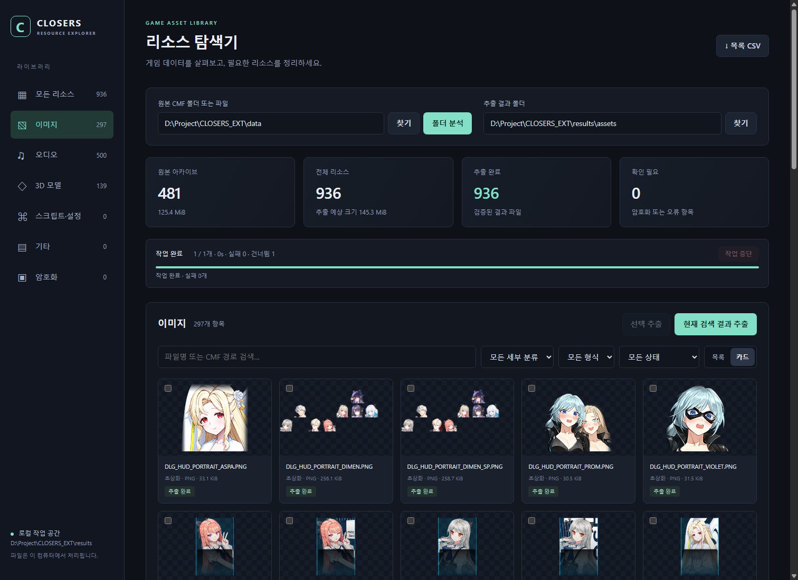

# CLOSERS Explorer

로컬 CMF 파일을 분석·추출하고 이미지·오디오·텍스트, 이미지 조합, 3D 모델·XMD 동작을 확인하는 프로그램입니다. Python 엔진과 한국어 브라우저 화면을 제공합니다. 설치와 첫 실행은 [저장소 README](../README.md)를 참고하세요.

기존 CMF-Sharp의 헤더 구조와 구형 디코딩 알고리즘을 참고했으며, 관련 고지는 [THIRD_PARTY_NOTICES.md](THIRD_PARTY_NOTICES.md)에 보존되어 있습니다. 기존 C# 프로젝트는 이 저장소에 포함하지 않으며 실행에도 필요하지 않습니다.

게임 원본·샘플 CMF, 기존 분석 DB·추출 결과, 진단 자료와 개발 보고서·계획 문서는 저장소에 포함하지 않습니다. 사용할 CMF 파일은 직접 준비하세요.



## 실행

**이 폴더의 `Start.cmd`를 더블클릭하세요.** 브라우저에서 `http://127.0.0.1:8765`가 열립니다. 처음 실행하면 원본 CMF 폴더를 직접 지정해 분석해야 합니다. 이후에는 기존 작업 공간의 목록과 추출 결과를 이어서 사용합니다. 기본 작업 폴더는 저장소 루트의 `results/`입니다.

- Python 3.10 이상이 필요합니다. 개발·검증 환경은 Windows / Python 3.12입니다.
- CMF 분석·추출, PNG 미리보기와 오디오 재생에는 추가 Python 패키지가 필요하지 않습니다.
- DDS/TGA 미리보기는 선택 의존성인 Pillow를 사용합니다. 필요하면 `python -m pip install Pillow`로 설치하세요. 미설치 상태에서도 원본 DDS/TGA 추출은 가능합니다.
- 로딩 이미지 조합의 게임 등록 데이터 복원에는 pycryptodome이 필요합니다. 썸네일과 DDS/TGA 합성 입력 변환, JPEG/WebP 등 일부 형식의 해상도 확인에는 Pillow가 필요합니다.
- 3D 보기는 WebGL2 브라우저가 필요합니다. 포함된 Three.js를 로컬에서 사용하므로 CDN 연결이나 추가 Python 3D 패키지가 필요하지 않습니다. DDS/TGA 텍스처는 원본 해상도 이미지 변환 경로를 사용합니다.
- 서버를 실행한 콘솔 창을 열어 두세요. 종료할 때는 그 창에서 `Ctrl+C`를 누르세요. 브라우저 탭만 닫으면 서버는 계속 실행됩니다.
- 포트가 사용 중이면 `python explorer.py serve --port 8766`으로 실행할 수 있습니다.

## 사용 순서

원본 CMF 경로와 추출 결과 경로는 같은 브라우저·로컬 주소에서 작업 폴더별로 기억하며, 새로고침 후에도 복원합니다. 브라우저 저장 데이터를 지우거나 주소·포트가 달라지면 기본 경로로 시작합니다.

1. 원본 CMF 폴더를 입력하거나 **찾기**로 선택하고 **폴더 분석**을 누릅니다. 하위 폴더도 탐색합니다. 단일 CMF 파일 경로도 입력할 수 있습니다.
2. 왼쪽 분류와 파일명 검색, 세부 분류·형식·상태 필터로 목록을 좁힙니다. **목록 / 카드**로 보기를 바꿀 수 있습니다.
3. 항목을 누르면 목록/본문 복원/로컬 저장/저장 바이트 보존/미리보기 상태를 따로 확인할 수 있습니다. 추출한 파일은 **원본 형식 내려받기**, **파일 위치 확인**으로 접근하며, 위 **저장 폴더 열기**로 추출 결과 폴더를 엽니다. 내려받기는 변환·축소 미리보기와 별개이며 원래 파일명을 사용합니다.
4. **현재 검색 결과 추출**은 현재 필터에 맞는 모든 페이지의 파일을 추출합니다. 체크박스로 고른 파일만 처리하려면 **선택 추출**을 사용하세요. 선택은 페이지나 검색 조건을 바꾸면 초기화됩니다.
5. 진행 중 **작업 중단**을 누르면 완료 파일은 남기고 현재 임시 파일을 정리합니다. 같은 입력·출력으로 재실행하면 완료 파일의 SHA-256을 확인한 뒤 건너뜁니다.

**분석하고 바로 추출**은 CMF 하나의 분석을 마치면 바로 추출합니다. 현재 검색 조건을 적용하며 기존 정상 목록과 완료 파일을 재사용합니다. 탐색이 끝나기 전에는 전체 수량을 확정하지 않습니다. **빠른 재개**는 기록된 크기·수정 시각으로 확인하므로 같은 메타데이터를 유지한 내용 변경을 찾지 못합니다. 기본값은 전체 SHA-256 검증이며 구 DB에 크기·시각 기록이 없으면 빠른 모드도 해시를 확인합니다.

**통합 추출 동시 처리**는 CMF 1·2·4개를 선택할 수 있습니다. 기본은 1이며 저장 장치·파일 구성에 따라 2/4개가 더 빠르지 않을 수 있습니다. 대기 작업 수를 워커 수까지 제한하고 워커별 스트리밍·DB 연결을 사용합니다. 중단 시 각 워커의 정리와 완료 결과 반영을 기다립니다.

같은 원본·복원기 버전의 본문 복원 실패는 기본적으로 재사용하며 **복원 실패 재사용** 개수로 표시합니다. 오류가 해결됐다는 뜻은 아닙니다. **이전 아카이브·본문 복원 실패도 다시 시도**를 체크하면 다시 실행하고, 상세의 **이 파일 추출·재시도**는 강제로 시도합니다. 원본 크기·수정 시각이나 복원기 버전이 바뀌면 캐시를 무효화합니다. 디스크/권한/원본 누락 등 I/O 오류는 재사용하지 않습니다.

추출 시 이 옵션 또는 `--retry-errors`를 사용하면 완료 항목도 원본 본문을 다시 읽어 검증합니다. 크기·수정 시각이 유지된 원본 변경이 의심될 때 사용하세요. 변경된 항목 목록은 먼저 강제 재분석해야 합니다. 기존 저장 파일은 덮어쓰지 않으며, 내용이 같으면 재사용하고 다르면 별도 이름으로 저장합니다. 빠른 재개를 선택해도 명시적 재시도에서는 원본을 다시 읽으므로 시간이 더 걸릴 수 있습니다.

게임 업데이트 후 **원본 변경 비교**를 누르면 지정 범위의 추가·변경·사라짐·동일을 확인할 수 있습니다. 마지막 성공한 분석의 크기·수정 시각 기준이며 기존 목록과 저장 파일은 유지됩니다. 분석에 실패한 원본은 동일로 판정하지 않으며 실패 수와 사유를 함께 표시합니다. 변경 원본을 분석하면 기존 저장 기록은 버전 이력에 남으며 상세의 **이 CMF의 이전 버전 저장 이력**에서 100개씩 조회·다운로드할 수 있습니다. 같은 이름의 새 내용은 기존 파일을 보존하고 별도 이름으로 저장합니다.

그룹 기준에서 **세부 분류 / 파일명 / 원본 폴더 / CMF / 퀘스트 음성 코드 후보**를 선택할 수 있습니다. 그룹을 열고 현재 검색 결과를 추출하면 모든 페이지를 처리합니다. 사용자 그룹 이름과 태그는 재분석 후에도 유지되며 기존 추출 파일은 이동하지 않습니다. 파일명 그룹은 마지막 `_숫자`만 제외합니다. 퀘스트 후보는 실제 관찰한 `ST_QUEST_<종류>_<숫자>` 패턴으로 묶으며 퀘스트명·화자·대화 순서를 뜻하지 않습니다. **그룹 음성 듣기**는 목록 순서로 이전/다음·연속 재생하고 200개씩 가져옵니다.

스크립트 미리보기는 UTF-8·BOM UTF-16·CP949 자동 판별과 수동 인코딩 선택을 제공합니다. 앞부분 4 KiB에서 시작해 **더 보기**로 최대 1 MiB까지 읽습니다. 화면 표시·검색은 최대 10,000줄이며 복사는 불러온 본문에 적용합니다. 본문 읽기에 실패해도 원본 경로·형식·오류 정보는 표시합니다. 스크립트는 실행하지 않으며 전체 스크립트 검색이나 복호화 기능은 없습니다.

일반 추출이 실패하는 스크립트도 **미지원 데이터 보존 · 인덱스 내보내기**에서 별도로 저장할 수 있습니다. 상태를 **오류**, 검색어를 `SCRIPT`로 좁히고 **현재 검색 결과 저장 바이트 보존**을 누르면 TET는 `.TET`, 다른 형식은 `.stored.bin`으로 저장하고 원래 이름·원본 위치·SHA-256을 담은 `preservation.sqlite3`를 만듭니다. 같은 보존 폴더로 재실행하면 해시를 확인하여 건너뜁니다. 이는 저장된 바이트의 복사이며 읽을 수 있는 스크립트 원문 복원이 아닙니다. 운영 DB의 오류 상태나 기존 추출 경로를 변경하지 않습니다. **보존 폴더 열기**를 누르면 Windows 탐색기에서 해당 폴더를 확인할 수 있습니다. 기존 TET의 `.stored.bin`은 그대로 두고 재실행 시 `.TET`를 별도로 만듭니다. 일반 추출 실패 시 자동 전환되는 기능은 아니므로 **저장 바이트 보존** 버튼을 사용하세요. 작업 진행에는 아카이브 실패와 내부 항목 실패를 구분해 표시합니다.

**목록 CSV**를 요청하면 현재 목록의 전체 CSV를 생성하고 변경이 없으면 재사용합니다. 작업 종료마다 자동 생성하지 않습니다. 작업이 진행 중이면 완료 후 요청하세요. 파일로 남아 있는 기존 CSV·요약은 이전 스냅샷일 수 있으며 `python explorer.py report`로 둘 다 명시적으로 갱신할 수 있습니다.

## 데이터 관리 · 전체 초기화

사이트 상단 **데이터 관리**에서 삭제할 파일 수·크기·저장 위치를 확인한 뒤 `전체 초기화`를 입력하고 **전체 초기화 실행**을 누릅니다. 진행 중인 분석·추출·보존 작업은 완료하거나 중단한 후 사용하세요. 초기화는 삭제 후 화면을 자동으로 새로고침하며, 원본 폴더를 지정해 다시 분석·추출할 수 있습니다.

- 분석 목록, 오류 및 버전 이력, 그룹 이름·태그, 기본 `assets` 폴더의 생성 파일, 미리보기·이미지 조합 캐시와 보고서를 삭제합니다. 별도 출력 폴더에서는 현재 목록과 버전 이력에 기록된 추출 파일만 삭제합니다. 폴더 자체와 관련 없는 파일은 유지합니다.
- 원본 CMF 파일과 원본 폴더는 유지합니다. 관리 폴더 안의 `.CMF`도 삭제 대상에서 제외합니다. 링크·Windows 정션을 통한 삭제는 차단합니다.
- **연결된 보존 데이터도 삭제**는 기본 해제입니다. 보존 데이터는 원본 경로가 아니라 별도로 복사한 `.TET`·`.stored.bin`과 보존 기록입니다. 선택하면 연결된 보존 DB의 기록 파일, 해당 보존 폴더의 `stored` 생성 파일과 보존 DB·요약을 삭제합니다. 해제하면 보존 파일과 연결을 유지합니다.
- 별도 진단 폴더, HEADER 인덱스, 연결하지 않은 보존 폴더와 브라우저로 내려받은 파일은 삭제하지 않습니다. 열어 둔 3D·이미지 조합 탭은 초기화 후 새로고침하세요.

삭제는 되돌릴 수 없습니다. 확인 후 파일이나 기록이 변경되면 삭제 범위를 다시 확인해야 합니다. 삭제 중 파일 잠금·권한 오류가 발생하면 이미 삭제한 파일은 복구하지 않으며, 남은 파일을 다시 찾을 수 있도록 분석 기록을 유지합니다.

## 일러스트·프레임 이미지 조합

저장 해상도는 실제 픽셀 크기로 표시하며 사용자 지정일 때만 너비 입력이 나타납니다. 배치 기준·메모리 정보는 **화면 정보**에 접어 두며, 캔버스 아래에는 미리보기 배율만 표시합니다. 모바일도 에셋 선택 → 미리보기 → 구성 요소 순서로 배치됩니다. 상단 **초기화** 버튼은 현재 조합과 저장 해상도·배경 설정을 초기화합니다.

1. 라이브러리 상단 **이미지 조합**을 누릅니다. 체크한 이미지들은 **선택 이미지 조합**, 상세의 이미지는 **이미지 조합에 추가**로 편집기에 보낼 수 있습니다.
2. **에셋 선택**의 **일러스트 / 프레임** 탭에서 썸네일을 눌러 적용합니다. 마크는 **추가 장식 → 마크 찾아보기**에서 선택합니다. 일러스트 등록·변환 테이블에서 로딩 용도와 해당 캐릭터에 등록된 이미지만 표시하며, 썸네일과 합성 모두 `LOADING_DUNGEON` 영역을 사용합니다. 게임의 자르기 영역이 원본 경계를 넘으면 실제 이미지와 겹치는 부분으로 보정하고 표시 크기는 유지합니다. 기존 조합 설정도 불러올 때 같은 보정을 적용합니다. 일러스트·프레임 이름은 한국어 게임 문자열을 우선 표시하고 이름·번호·캐릭터로 검색할 수 있습니다.
3. 배치 기준은 게임 던전 로딩 UI의 일러스트 표시 영역(현재 데이터 450×640)으로 유지합니다. **저장 해상도**의 기본값은 **원본 해상도 유지**이며, 보이는 일러스트의 자르기 영역을 축소하지 않도록 출력 배율을 계산합니다(기준 크기보다 작게 저장하지 않음). 워터붐 페스타는 720×1024로 저장합니다. **기준 크기 · 1배**, **기준 크기 · 2배**(900×1280), **사용자 지정**도 선택할 수 있고, 사용자 지정은 너비를 입력하면 높이를 같은 비율로 계산합니다. PNG·APNG·WebP 모두 원본 이미지·프레임·효과를 선택한 해상도에 직접 합성하며, 미리보기 크기는 바뀌지 않습니다. 원본보다 큰 출력이 새 디테일을 만들지는 않습니다. 저장 설정은 조합 JSON에 보관하고, 이전 설정에는 원본 해상도 유지가 적용됩니다. 일러스트 선택은 이전 일러스트를 교체하며, 게임 영역에 맞춘 기본 배치를 잠근 상태로 추가합니다. **구성 요소**에는 일러스트·프레임·추가 장식이 묶여 표시되며 체크 상자로 묶음 전체를 숨기거나 표시합니다. 묶음을 펼쳐 조각을 선택하면 **세부 편집**이 열립니다. 여기서 필요한 레이어의 잠금을 풀어 좌표·크기·불투명도·순서를 편집할 수 있습니다. 용도는 읽기 전용이며, UV·자르기·출처 정보도 세부 편집에서 확인합니다.
4. 프레임 썸네일은 TOP·BOT 조각을 조립한 모습이며, 효과가 등록된 프레임에는 **게임 효과** 표시가 붙습니다. 마크는 해당 UV 영역 하나만 보여주며 프레임과 독립적으로 교체합니다. 같은 로딩 UI에 마크의 위치·크기가 등록되어 있으면 적용합니다. 현재 데이터에는 별도 마크 위치가 없어 안내를 표시하고 교체 전 위치를 유지합니다. 마크의 별도 효과는 마크 중심에 연결해 함께 이동·확대합니다. 다른 화면용 좌표를 로딩 화면에 적용하지 않습니다. 게임 정의 복원에는 원본 CMF·CW.EXE와 pycryptodome, 썸네일 생성에는 Pillow가 필요합니다. [원본 데이터 적용 규칙](docs/LOADING_COMPOSITION.md)을 참고하세요.
5. **효과 재생**과 시점 입력으로 애니메이션을 확인합니다. **이미지 저장 · PNG**은 정지 이미지, **애니메이션 저장**은 지정한 길이·FPS의 반복 이미지를 만듭니다. **애니메이션 저장 설정**을 펼치면 형식·길이·FPS·순환 옵션을 조절할 수 있습니다. 기본값은 **WebP · 무손실**이며 APNG도 선택할 수 있습니다. 움직이는 효과가 없으면 애니메이션 저장과 재생 버튼은 비활성화됩니다. WebP는 Pillow가 필요하며 반투명 알파와 색상을 보존합니다. 프레임마다 화면을 완전히 교체하므로 투명 영역에 이전 그림을 남기지 않습니다. 두 형식 모두 최대 250프레임·128 MiB입니다. 새 조합은 배경색을 포함합니다. 워터붐 페스타처럼 원본 가장자리가 투명하게 흐려지는 일러스트도 배경색 위에 합성합니다. 미리보기는 설정과 분리된 영역에 유지됩니다. 데스크톱은 왼쪽 에셋 선택·중앙 미리보기·오른쪽 설정 패널로 구성하며, 좁은 화면에서는 미리보기 아래 **에셋 / 꾸미기 / 구성 요소 / 저장 설정** 탭으로 전환합니다. 설정을 펼쳐도 미리보기의 위치와 크기를 유지하고, **크게 보기**로 현재 결과를 확대할 수 있습니다. 미리보기 아래 저장 크기를 누르면 해상도 설정으로 이동합니다. **꾸미기 → 배경 스타일**을 펼치면 **게임 기본 / 단색 / 투명**을 선택할 수 있습니다. 게임 기본은 **검은양 / 늑대개 / 사냥터지기 / 시궁쥐** 팀을 선택하며, 등록된 팀별 UV를 우선 사용하고 전용 UV가 없으면 전체 텍스처를 카드 영역에 맞춥니다. 추가 확대나 중앙 자르기를 하지 않으며, 게임의 `m_BGColor`를 RGB 보정과 알파에 적용합니다. 게임의 최종 UV·색상 합성 방식과의 일치는 추가 확인이 필요합니다. **불투명도** 슬라이더는 현재 기본 모습을 100%로 유지하면서 배경 이미지를 0~100%로 조절합니다. **기본** 버튼으로 100%로 복원하며 일러스트·프레임에는 영향을 주지 않습니다. 조절값은 팀 변경과 조합 저장·복원 시 유지됩니다. **로딩창에서의 크기 · 위치**를 펼치면 전체 로딩창(1920×1080), 카드(454×724), 저장되는 일러스트 영역(450×640)의 관계를 볼 수 있습니다. 이 미리보기의 초록 테두리가 현재 저장 영역이며 다른 슬롯은 위치를 확인하는 윤곽으로 표시합니다. 단색은 추천 색상 5종이나 색상 선택기로 조절하며, 투명은 일러스트·프레임만 저장합니다. PNG·APNG·WebP와 조합 설정 저장·복원에 같은 배경이 적용됩니다. 게임 배경이 있는 조합은 JSON 버전 6으로 저장하며 이전 버전 설정도 불러올 수 있습니다. **캐릭터 정보**에서 하단 정보 포함을 켜면 레벨 표기·캐릭터명/직함·닉네임·진행률을 편집하고 원본 요원 등급 엠블럼 8종을 선택할 수 있습니다. 실제 게임 글꼴·글자 크기·색상·정렬을 사용하며, S~X 등급의 엠블럼 애니메이션도 저장합니다. 기본 출력은 정보 영역을 포함해 450×720으로 확장되고, 조합 JSON 버전 7에 설정을 보관합니다. [게임 데이터와 재현 범위](docs/LOADING_CARD_INFO.md)를 참고하세요. 프레임 템플릿을 추가할 때는 현재 배경을 유지합니다.
6. **자연스러운 순환**을 켜면 효과의 초기 생성 구간을 제외하고 끝과 시작을 부드럽게 연결해 저장합니다. 연결 구간에는 두 시점의 효과가 겹칠 수 있으며, 원본 그대로 저장하려면 끄세요. **게임 효과 시간 정보**에서 실제 주기·정지 시간·지연·입자 수명을 확인합니다. **텍스처 주기 길이 적용**은 저장 한도 내의 공통 텍스처 주기를 적용합니다. 무작위 입자까지 원위치로 돌아오는 게임 전체의 고정 주기가 있다는 뜻은 아닙니다. 짧은 프레임이 생략되는 경우 저장 FPS를 높일 수 있습니다.
7. 상단 **조합 관리**의 **조합 설정 저장/불러오기**는 애니메이션의 모든 원본 출처·해시·프레임 시간을 함께 보관합니다. 조합 JSON은 효과 종류에 따라 버전 1·2·3을 사용하며 이전 설정도 읽습니다. **프레임 템플릿 저장/추가**로 다른 조합에 재사용할 수 있습니다. 저장 위치는 브라우저 다운로드 설정을 따릅니다.

합성 입력은 축소 미리보기와 분리해 원본 해상도를 사용합니다. 기존 원본·추출 파일은 변경하지 않습니다. 설정 복원은 출처와 해시를 확인하며 이미지가 바뀌거나 없어지면 오류를 표시하고 현재 조합을 유지합니다. 현재 절대 원본 경로를 사용하므로 폴더 이동/업데이트 전 자료의 자동 재연결은 지원하지 않습니다.

게임 NTF·TET·로딩 UI Lua·PARTICLE_SYSTEM_UI·TEX_ANIM_DATA를 읽으며 게임 코드는 실행하지 않습니다. 현재 로컬 등록 효과 81종에서 쓰는 확률 방출·수명·색상·크기·이동·회전·UV 스크롤·마스크·이중 블렌딩·텍스처 애니메이션을 프레임과 별도 마크에 적용합니다. 선택 시 자동 재생하며 WebGL이 필요합니다. 미리보기와 PNG·APNG 저장은 같은 재생기를 사용하고 조합 JSON 버전 3에 난수 시드와 효과를 보관합니다. 이전 버전 1·2 설정도 불러옵니다. 고정 시드를 사용하므로 게임 실행 중의 무작위 배치와 차이가 있으며, 새 데이터의 알 수 없는 이벤트나 없는 에셋은 경고로 표시합니다.

레이어는 20개, 애니메이션 프레임 포함 원본은 256개, 입력은 이미지당 16,777,216픽셀·64 MiB, 불러온 원본 합계는 134,217,728픽셀까지입니다. 저장 출력은 한 변 8,192픽셀·합계 16,777,216픽셀까지입니다. 애니메이션은 전체 프레임의 픽셀 합계가 WebP 134,217,728픽셀, APNG 268,435,456픽셀을 넘으면 생성 전에 안내합니다. 저장 크기·길이·FPS를 줄여 조절할 수 있습니다. 전체 브라우저 메모리 상한을 보장하는 값은 아닙니다.

## 추출 후 데이터 후처리

라이브러리의 모든 리소스·그룹, 3D 모델·의상 묶음, 이미지 조합의 일러스트·프레임·마크에는 원본 CMF 수정일을 표시하며 최신순·오래된순으로 정렬할 수 있습니다. 날짜는 분석 당시 기록한 원본 수정일이므로 업데이트 후 폴더를 다시 분석하세요. 개별 아이템 출시일이나 내용 변경일을 뜻하지 않으며 같은 CMF의 항목들은 날짜가 같을 수 있습니다. 그룹·의상 묶음은 포함된 원본 중 가장 최근 날짜를, 이미지가 없는 프레임은 등록 정보 원본의 날짜를 사용합니다.

웹 작업 설정의 **추출 후 데이터 후처리**는 기본으로 켜져 있습니다. **분석하고 바로 추출**, 선택 추출, 검색 결과 추출이 끝나면 한국어 이름·아이템 아이콘·장비 메시 표시 규칙 인덱스를 생성합니다. **폴더 분석**만 실행할 때는 후처리하지 않습니다. 필요한 패키지는 먼저 설치하세요.

```powershell
python -m pip install Pillow pycryptodome
```

**게임 실행 파일 (CW.EXE)** 경로를 입력하거나 비워 두면 분석된 원본 CMF 폴더와 그 상위 폴더에서 자동으로 찾습니다. 후보가 없거나 여러 개면 경로를 직접 입력해야 합니다. 실행 파일은 읽기만 하며 실행하지 않습니다. 사용 여부와 경로는 같은 브라우저·로컬 주소에서 작업 폴더별로 기억합니다.

이미 언팩한 데이터에는 **후처리만 실행**을 사용하세요. 게임 업데이트 후 CMF를 다시 분석하고 이 버튼을 누르면 인덱스도 갱신됩니다. 후처리는 추출 필터와 별개로 현재 작업 폴더의 분석 목록 전체를 사용하므로, 이름 연결에 필요한 NTF와 FRAME_UNIQUE_ID.LUA가 든 원본 CMF도 분석되어 있어야 합니다.

진행 상태와 단계별 결과를 웹에 표시합니다. 패키지 누락·원본 변경·지원하지 않는 게임 버전 등으로 실패하면 추출 결과와 마지막 정상 인덱스를 보존하고 확인 필요로 표시합니다. 중단하면 이후 단계를 실행하지 않으며, 생성 중인 이름 인덱스는 게시하지 않습니다. 원인을 해결한 후 후처리만 다시 실행할 수 있습니다. 기존 CLI `names` 명령도 계속 사용할 수 있습니다.

새 데이터 처리를 추가하는 개발 방법은 [후처리 확장 안내](docs/POSTPROCESSING.md)를 참고하세요.

## 3D 모델·게임 동작 보기

**묶음 열기 / 현재 모델에 적용**에서 선택이 빠진 모델이 있으면 해당 선택란에 노란 테두리와 안내를 표시하고 첫 번째 누락 항목으로 이동합니다. 필요한 장착 패널과 상세 항목은 자동으로 펼칩니다. 모델을 선택하거나 해당 부위를 제외하면 안내가 사라집니다. 선택할 후보가 없으면 원본 확인 또는 부위 제외를 안내하며, 동작 줄이기 설정에서는 강조 애니메이션을 생략합니다.

뷰어는 화면 높이에 맞춰 유지되며 의상 목록과 장착 정보는 각각 스크롤합니다. **장착 접기 / 장착 보기**로 중앙 공간을 조절하고, **크게 보기**로 현재 모델과 시점을 유지한 채 화면을 확대합니다. **원래 크기** 또는 `Esc`로 돌아옵니다. 너비 1500px 이하에서는 장착 패널을 기본으로 접습니다. 900px 이하에서는 뷰어와 **의상 탐색 / 장착 부위** 전환 버튼을 표시하며, 부위 필터·정렬·검색 조건 초기화는 **필터 · 기록**에서 사용합니다. 가로로 긴 작은 화면에서는 탐색 패널과 뷰어를 나란히 배치합니다.

의상·부위·액세서리는 게임의 아이템 번호와 타입별 의상 코드로 구분합니다. 같은 X 모델을 공유해도 A·B·C·SP 등 등록된 타입은 서로 다른 항목·세트로 표시하며, 상세 필터의 **아이템 타입**은 현재 데이터에서 구성합니다. 등급 등 아이템 번호가 다른 항목도 번호와 출처를 별도로 보존합니다. 선택한 아이템 정보는 부위 교체·세트 적용·즐겨찾기·페이지 주소 복원에 유지됩니다. 타입별 외형은 XET_TABLE의 실제 텍스처 변경표를 사용하므로 다른 캐릭터와 공유하는 재질도 등록된 연결대로 변경합니다. 표시 정의나 원본 텍스처가 없으면 적용 오류를 안내하며, 게임 툰 셰이더·발광 등의 효과 차이는 현재 재현 범위 밖임을 표시합니다. 첫 아이템 등록 정보 복원은 시간이 걸리며 이후에는 원본 변경을 검증하는 캐시를 사용합니다.

탐색 영역의 상단과 목록은 높이를 분리해 필터·탭 전환 시 목록 시작 위치를 유지합니다. 부위 버튼은 한 줄로 스크롤하며, 긴 검색 조건은 한 줄 요약으로 표시합니다. **필터 · 기록**에서 상세 조건·즐겨찾기·최근 사용·원본 자료 탐색을 열 수 있습니다. 대화상자는 닫기 또는 Esc로 닫을 수 있고, 열고 닫아도 목록 스크롤은 유지합니다. 목록 조회 중 안내와 오류는 목록 영역에 표시합니다.

처음에는 캐릭터를 선택하며, 선택 전에는 아바타 목록을 조회하지 않습니다. 선택 후 **의상 세트 / 부위별 / 눈동자 / 액세서리**로 탐색합니다. 부위별은 무기·헤어·상의·하의·장갑·신발·한 벌을 우선 표시하고 **부위 교체**로 현재 구성에 적용합니다. 한 벌과 상·하의는 교체 관계를 처리하며 출처가 하나로 확인된 ALPHA 보조 메시를 함께 적용합니다. **기본 아바타 구성**에서는 기본 부위와 출처를 확인한 후 묶음을 열 수 있습니다. 액세서리는 해당 탭을 열 때 조회하며 선택한 캐릭터의 모델과 공용 모델을 구분합니다. NPC·몬스터·보조 메시의 개별 탐색은 **원본 자료 탐색**에 있습니다. 캐릭터별 조회 결과를 캐시하며 재분석 또는 이름 인덱스 갱신 시 무효화합니다.

**눈동자** 탭에서 캐릭터별 기본 눈동자와 다른 눈동자를 이름으로 찾아 적용할 수 있습니다. 눈동자는 게임 아이템 등록 정보로 구분하며, 같은 얼굴을 공유해도 서로 다른 텍스처는 별도로 표시합니다. 이름·표시 데이터가 같은 이벤트·능력치 변형은 한 항목에 모으고 상세에 아이템 번호를 보존합니다. **눈동자 적용**은 현재 캐릭터의 의상을 유지하고, **기본 눈동자 적용**은 기본 모습으로 되돌립니다. 별도 눈 메시를 쓰는 항목도 지원하며 기존 눈과 겹치지 않게 표시합니다. 여러 출처가 있으면 상세에서 선택하세요. 원본에서 찾지 못한 항목은 목록에 남기고 적용할 수 없는 이유를 표시합니다. 눈동자 탭을 열면 미추출 항목까지 포함한 전체 목록을 표시합니다. 첫 조회는 게임 정의 복원 시간이 필요하며, 이후에는 원본 변경을 확인하는 캐시를 사용합니다.

아바타 이름 인덱스가 있으면 라이브러리·3D 모델 목록·장착 부위에 한국어 인게임 이름을 우선 표시하고 이름으로 검색할 수 있습니다. 원본 파일명과 출처는 함께 유지합니다. 공유 모델에 여러 아이템 이름이 연결되면 `외 N개`로 표시하며, 제목에 마우스를 올리면 다른 이름도 확인할 수 있습니다. 이름을 찾지 못한 모델은 파일명으로 표시합니다. 묶음 제목에는 부위 이름들의 공통 접두어를 표시하며 묶음 구성은 기존 파일명 코드 기준입니다.

이름 인덱스는 게임 설치본의 NTF 테이블을 읽어 작업 폴더에 별도로 생성합니다. 웹의 추출 후 후처리 또는 **후처리만 실행**으로 생성·갱신할 수 있으며, CLI에서는 다음 명령을 실행하세요. 일반 탐색에는 추가 패키지가 필요 없고, 인덱스 생성에만 `pycryptodome`이 필요합니다.

```powershell
python -m pip install pycryptodome
python explorer.py names --executable "C:/Program Files (x86)/NaddicGames/Closers/CW.EXE"
```

다른 작업 폴더는 `python explorer.py --workspace "D:/CLOSERS-work" names --executable ".../CW.EXE"`로 지정합니다. 해당 폴더에 CMF 분석 목록이 있어야 합니다. 결과는 `game-names.sqlite3`이며 게임 파일이나 기존 추출 파일의 이름을 바꾸지 않습니다. 테이블의 원본 CMF가 바뀌면 이름 표시를 중단하므로 재분석 후 인덱스를 다시 생성하세요. 원본이 없는 오프라인 환경에서는 저장된 인덱스를 사용할 수 있습니다. 전체 초기화에는 이름 인덱스도 포함됩니다.

이 인덱스에는 원본 게임의 장비 메시 그룹과 표시 우선순위도 함께 저장합니다. 상·하의와 신발을 조합할 때 낮은 우선순위의 다리 메시 등을 숨겨 겹침을 줄이며, 화면과 목록 미리보기에 동일하게 적용합니다. 기존 인덱스는 위 명령으로 다시 생성해야 표시 규칙이 추가됩니다. **장비 숨김 해제**로 숨긴 메시를 다시 확인할 수 있습니다. 염색용 DYE 메시가 빠진 구성은 빈 공간이 생기는 것을 막기 위해 해당 숨김을 보류합니다. [적용 범위와 검증](docs/MODEL_VISIBILITY.md)을 참고하세요.

다른 장비 부위를 가리는 아바타는 게임 테이블의 부위 전체 숨김 목록도 적용합니다. 예를 들어 티나 늑대개 특수대원 슈트는 함께 불러온 상의·하의·신발·장갑을 숨기고 머리·얼굴은 유지합니다. 나중에 부위를 추가해도 슈트의 표시가 우선하며, 슈트를 제거하면 다른 부위가 다시 나타납니다. 새 환경에서는 후처리로 자동 생성되며 기존 환경은 **후처리만 실행**으로 갱신할 수 있습니다.

3D 목록 미리보기는 게임 테이블에서 모델·캐릭터·의상 타입에 연결된 **인게임 아이템 아이콘**을 우선 표시합니다. 의상별 목록에는 한 벌·상의·머리 등의 대표 부위를 고르며, 전체 코스튬 일러스트를 뜻하지 않습니다. 아이콘 종류는 마우스를 올리면 확인할 수 있습니다. 여러 이미지 후보가 남거나 이미지가 없으면 기존 3D 미리보기를 사용합니다. 이미지 파일명은 테이블에 기록된 값을 사용하며 다른 캐릭터의 공용 아이콘도 허용합니다.

아이콘 PNG는 추출 필터와 별개로 분석된 원본 CMF에서 읽어 `game-names.sqlite3`에 함께 저장합니다. 모델만 추출한 새 환경에서도 후처리로 생성되며, 생성 후 원본 CMF 없이 사용할 수 있습니다. 아이콘이 든 CMF도 분석 목록에 있어야 합니다. 기존 환경은 **후처리만 실행** 후 3D 페이지를 새로고침하세요. 게임 테이블·아이콘 원본이 변경되면 재분석과 후처리가 필요하며, 실패·취소 시 기존 정상 인덱스를 유지합니다.

현재 한국 설치본의 NTF 구조와 실행 파일 내 복원 경로를 지원하며, 다른 버전에서 형식·키 위치가 달라지면 생성에 실패할 수 있습니다. 실패한 갱신은 기존 인덱스를 덮어쓰지 않습니다. 이 기능은 이름 연결용 13종 테이블만 복원하며 일반 추출기의 모든 스크립트 복원을 지원한다는 뜻은 아닙니다. 각 이름의 아이템 번호·문자열 키·테이블·원본 해시는 인덱스에 기록합니다.

**캐릭터별 분류와 아바타 묶음:** 3D 보기의 모델 찾기는 **의상별** 목록으로 시작합니다. **부위별**에서는 정렬 옆 드롭다운으로 부위를 선택합니다. 데스크톱과 모바일 모두 같은 줄에서 부위·정렬을 조절하며, 다른 모드에서는 정렬 영역을 넓혀 사용합니다. 캐릭터를 고른 뒤 **묶음 구성**을 누르면 별도 상세 패널에서 부위·얼굴·공용 뼈 출처를 골라 한 번에 열 수 있습니다. **묶음 열기**는 현재 모델 전체를 교체하고, **현재 모델에 적용**은 같은 캐릭터의 선택한 부위만 교체합니다. ALPHA는 기본 포함, 무기·액세서리·DYE는 선택 사항이며 중복 출처는 직접 고릅니다. **개별 파일**에서는 NPC·몬스터와 모든 모델을, **공통 액세서리**에서는 묶음에 속하지 않는 공통 액세서리를 찾습니다. 의상 코드는 파일명 기준이며 실제 의상명을 뜻하지 않습니다. 라이브러리의 3D 모델 분류에서도 같은 캐릭터·종류·의상·부위·보조 메시 필터를 사용합니다.

캐릭터 선택 전에는 검색·분류·정렬 영역을 접고 선택 안내만 표시합니다. 패널 제목 옆 **기록** 버튼으로 즐겨찾기·최근 기록을 열 수 있으며, 캐릭터 선택 후에는 같은 버튼이 **필터 · 기록**으로 바뀝니다.

페이지 번호와 처음/끝, 페이지 직접 입력으로 이동할 수 있으며 페이지당 20·40·60개를 선택합니다. 목록 이동은 모델 로딩 중에도 사용할 수 있습니다. **아바타 꾸미기**와 **장착 부위** 패널의 제목 옆 **접기 / 펼치기** 버튼으로 각 패널을 따로 접고 펼칩니다. 데스크톱에서는 접은 패널이 좁은 세로 막대로 남아 모델 화면이 넓어지고, 모바일에서는 제목과 펼치기 버튼을 유지합니다. 부위·의상 분류·보조 메시·저장 상태는 **상세 필터**에서 조정합니다. 적용한 모델은 목록에 **현재 적용 중**으로 표시합니다.

목록은 작은 아이콘과 이름 중심으로 표시하며, 이름을 누르면 의상 묶음을 구성하거나 개별 모델을 엽니다. 묶음 구성·모델 열기·부위 추가 등의 버튼은 이름 아래에 항상 표시합니다. 각 항목의 **상세**를 펼치면 파일명·분류·출처·저장 상태를 확인할 수 있습니다. 오른쪽 위의 **☆ / ★** 버튼으로 즐겨찾기를 추가하거나 해제합니다.

의상에 헤어 등 기본 부위가 빠져 있으면 **묶음 구성 → 빈 부위 기본 아바타 적용하기**를 누릅니다. 체크한 기본 부위는 유지하고 빈 부위만 같은 캐릭터의 BASIC 아바타 후보로 채웁니다. 정확한 BASIC 부위를 우선하며 없으면 BASIC 변형 후보를 표시합니다. 한 벌 의상과 상·하의는 겹치지 않게 처리하고 기본 부위의 ALPHA 보조 메시도 함께 추가합니다. 출처가 여러 개면 직접 선택하고, 기본 파일이 없는 부위는 안내를 확인하세요. 구성 확인 후 **묶음 열기** 또는 **현재 모델에 적용**을 눌러 3D 화면에 반영합니다.

목록에서 화면에 보이는 항목부터 인게임 아이템 아이콘을 불러옵니다. 아이콘이 없거나 불러오지 못하면 **아이콘 없음**을 표시합니다. 목록 로딩 비용을 줄이기 위해 아이콘 대신 실제 3D 모델 미리보기를 생성하는 동작은 비활성화했으며, 구현과 재활성화 안내 주석은 `web/model-preview.js`에 남겨 두었습니다.

**즐겨찾기**는 최대 30개, **최근 사용**은 최대 20개를 같은 브라우저에 기억합니다. 항목을 누르면 현재 목록에서 다시 찾으며 각 기록은 삭제할 수 있습니다. 검색어·필터·목록 방식·페이지·표시 개수·목록 확장 상태도 복원합니다. 기록은 브라우저의 해당 로컬 주소에 저장되므로 브라우저 저장 데이터를 지우거나 포트를 바꾸면 이어지지 않을 수 있습니다.

1. 라이브러리 상단 또는 X 상세의 **3D 보기**를 누릅니다. 의상별 목록에서 **묶음 구성 → 묶음 열기**를 누르거나, **개별 파일**에서 파일명으로 검색해 **현재 모델 교체**를 선택하세요.
2. 드래그로 회전, 휠로 확대, 오른쪽 드래그로 이동합니다. 모델 화면 왼쪽 아래의 **시점 초기화** 아이콘으로 전신 시점을 복원하고, 오른쪽 위 확대 아이콘으로 크게 봅니다. 아이콘에 마우스를 올리면 기능명이 표시됩니다. **기본 자세**는 **동작 변경** 창 맨 위에서 선택하며, 아바타와 동작을 모두 해제하는 **초기화**는 3D 미리보기 상단에 있습니다. 미리보기 상단의 **보기 설정**에서는 와이어프레임·뼈·보조 메시·발광 재질 미리보기를 조절하고, **배경 · 바닥**에서는 배경과 그림자를 조절합니다.

**보기 설정 → 의상 변경 시 시점 유지**는 기본으로 켜져 있습니다. 같은 캐릭터의 의상·부위·눈동자를 변경할 때 회전·확대·이동을 유지하고, 끄면 변경할 때마다 전신이 보이도록 조정합니다. 첫 모델 적용이나 다른 캐릭터로 변경할 때는 자동으로 조정하며, **시점 초기화**는 설정과 관계없이 사용할 수 있습니다. 선택값은 같은 브라우저·로컬 주소에 저장합니다.

3D 모델 화면의 **배경 · 바닥**에서 스튜디오, 중성 회색, 밝게, 어둡게, 기존 사이트 배경, 사용자 지정 색상, 배경 이미지를 선택할 수 있습니다. 기본값은 차콜 그라데이션과 부드러운 타원형 바닥 그림자이며, 그림자는 별도로 켜고 끌 수 있습니다. 배경 이미지는 PNG·JPEG·WebP(최대 20MB)를 지원하고 비율을 유지해 전체를 표시합니다. 선택 설정과 축소한 배경 이미지는 같은 브라우저·로컬 주소에 저장하며, **배경 · 바닥 기본값**으로 초기화할 수 있습니다.

3. NPC·몬스터는 같은 이름 XMD를 연결합니다. 캐릭터는 부위를 추가하고 **캐릭터 공용 뼈 / MOTION… 연결**을 누릅니다. 후보가 없으면 MOTION X를 먼저 열고 부위를 추가하세요. 텍스처·XMD 출처가 여러 개이면 직접 선택합니다.
4. 현재 동작 이름 옆의 **동작 변경**에서 캐릭터의 전체 XMD 묶음을 확인합니다. 기본·이동, 전투·피격, 스킬, 아바타 변형, 이모션, 로비·마을, 상호작용으로 나누며 파일명·개별 동작명으로 전체 검색합니다. 현재 의상 외의 아바타 모션도 표시합니다. 동작을 선택하면 현재 이름이 갱신되며, 아래 **재생**·타임라인·반복·속도로 조작합니다. 창 맨 위의 **기본 자세**를 고르면 동작을 해제하고 재생 조작을 비활성화합니다. 검증용 `_DEFAULT` 자세는 체크박스로 표시합니다.
   전체 뼈의 기본 자세 대조가 통과한 동작을 연결하며, 전용 뼈가 필요한 모션은 검증한 동명 X 파일이 하나일 때 선택 시 자동 전환합니다. 출처가 중복된 XMD는 각각 표시합니다. 읽기·뼈 검증에 실패한 파일도 사유와 함께 표시하며 정적 모델은 유지합니다. 종류는 파일명 근거이고 아바타 착용 조건은 확정하지 않습니다. 이름 인덱스가 있으면 이모션의 인게임 명칭을 원본 클립명과 함께 표시하고 한국어로 검색할 수 있습니다. 이전 인덱스는 **후처리만 실행**으로 갱신하세요. 명칭 출처는 각 항목에서 확인할 수 있습니다. [탐색 범위와 명칭 연결·검증 방식](docs/MODEL_MOTIONS.md)을 참고하세요.
5. 저장한 모델은 **원본 파일 저장**으로 내려받습니다. CMF가 없어도 저장한 X·XMD·텍스처가 남아 있으면 이용할 수 있습니다. 미추출 원본의 저장은 라이브러리에서 추출하세요.

**동작 변경 → 묶음 동작**에서는 시작·반복·종료 연결이 확인된 동작을 한 항목으로 선택할 수 있습니다. **재생**하면 반복 상태를 유지하며, 화면 아래 **종료하기**를 누르면 종료 동작을 재생합니다. 종료가 끝나면 같은 묶음 모션을 처음 선택한 시작 자세로 돌아가 정지하며, **재생**으로 다시 시작할 수 있습니다. **종료 후**에서 마지막 자세 유지를 선택할 수도 있습니다. 묶음 재생과 처음 상태로 복귀할 때는 현재 시점을 유지합니다. 묶음 재생은 게임 상태 연결에 따라 반복하므로 개별 클립의 반복 체크박스는 비활성화됩니다. 묶음 정보가 없는 이전 인덱스는 **후처리만 실행**으로 갱신하세요.

모션을 선택한 뒤 **연출 설정**에서 **보조 모델 표시**, **모션 효과 표시**를 각각 조절할 수 있습니다. 소품·메시 효과 외에 평면/메시 파티클, 텍스처 프레임 애니메이션, 생성률·수명, 색상·투명도·크기·회전·이동·중력과 이중 블렌딩을 미리보기합니다. 효과 내부의 자식 파티클도 부모 생성 시점에 맞춰 표시합니다. 탐색·정지·묶음 동작의 단계 전환과 초기화에도 함께 적용됩니다.

큐브 의자의 등장·퇴장처럼 디졸브 마스크가 연결된 효과는 원본 이미지와 색상·경계 폭·임계값 트랙을 이용해 근사 재생합니다. 효과별 크기 배율은 자식 파티클에도 적용됩니다. 묶음 타임라인을 이동하면 애니메이션 시간과 실제 시간 기준 효과를 함께 되돌립니다. 모션에 무기 숨김이 지정된 구간에는 무기를 숨기고, 구간이 끝나거나 동작을 해제하면 사용자의 장비 표시 설정을 복원합니다. 이전 인덱스에는 **후처리만 실행**으로 이러한 이벤트 정보를 추가하세요.

장비 조건은 **조건부 연출도 미리보기**로 선택하고, 같은 클립에 연결된 여러 게임 상태와 중복된 원본은 직접 고를 수 있습니다. 연출 XMD의 기본 자세 대조에 실패하면 동명 모델의 모든 뼈 행렬과 일치하는 클립 시작 자세로 연결을 검증합니다. 별도 XMD를 연결할 수 없는 바이크·선물 상자·곰인형 등은 같은 바이너리·텍스트 X 파일 안의 이름이 일치하는 `AnimationSet`을 재생합니다. 모델에 남아 있지 않은 프레임의 채널은 제외하고 기존 프레임의 동작을 유지합니다. 하이드처럼 이모션이 별도 XMD 묶음에 있으면 동일 모델 이름 계열에서 전체 기본 자세 검증을 통과한 유일한 출처를 연결합니다. 연결을 검증할 수 없으면 정적 모델로 표시하고 사유를 안내합니다. 텍스처가 없으면 단색으로 표시합니다. 연결 목록을 임의로 잘라내지 않으며, 동시 렌더링은 128개 연출/100만 정점/30만 애니메이션 변환, 파티클은 방출기당 256개로 제한합니다. 초과 시 항목을 선택해 나누어 볼 수 있습니다.

트리의 별처럼 보조 모델의 뼈에 붙는 자식 효과는 해당 모델의 동작을 따라갑니다. 부모 효과가 반복되면 자식 파티클도 생성 시점부터 다시 재생하며, 입자 수 제한에 도달하면 기존 입자의 수명과 텍스처 애니메이션을 유지합니다.

데모닉 하트비트의 바닥 하트처럼 색을 덧입히는 바닥 추적 메시는 같은 부모·상태·생성 시점·부착 위치에 연결된 유일한 기본 파티클의 알파 마스크로 범위를 제한합니다. 원본의 양면 표시 설정을 반영해 위아래 시점에서도 사각형 그라데이션 판이 드러나지 않도록 표시하며, 기본 효과가 꺼져 있거나 크기가 0인 동안에는 덧입히는 메시도 숨깁니다. 기존 인덱스는 **후처리만 실행**으로 파티클 설정을 갱신하세요.

아우라 픽시즈의 프리즘 링·육각형 등은 원본 `m_MaskTexName`의 회색조 마스크로 표시 영역을 제한합니다. 색상 텍스처의 UV가 움직여도 마스크 좌표는 유지하며, 전체 사각형이 겹쳐 과하게 하얗게 보이는 현상을 방지합니다. 원본의 점멸 주기와 발광 색·강도는 유지합니다.

원본의 `ROL_EFFECT_*` 레이어 순서에 따라 메시 효과와 파티클을 그립니다. 낮은 레이어의 검은 바닥이 높은 레이어의 빛을 덮지 않도록 시점별 거리 정렬보다 레이어를 우선합니다. 아우라 픽시즈 일반 액션에는 검은 반투명 바닥 효과가 원본에 포함되어 있고, 테마송 상태에는 이 효과가 없습니다. 이 차이는 유지합니다.

효과의 회전은 롤(Z)→피치(X)→요(Y) 순서로 합성합니다. 아우라 픽시즈의 원통형 빛처럼 먼저 세운 뒤 세로축으로 회전하는 메시가 바닥 원에서 기울어져 벗어나지 않도록, 파티클·메시 효과·부착 오프셋에 같은 회전 규칙을 적용합니다.

색상 블렌딩과 화면의 알파값은 별도로 합성합니다. 검은 반투명 바닥이 불투명 화면의 알파값을 낮춰, 뒤이어 그리는 `DESTALPHA` 발광 효과가 기존 색을 검게 지우는 현상을 방지합니다.

동작을 적용할 때 선택한 보조 모델·텍스처·효과와 묶음의 모든 구간을 준비한 뒤 재생 버튼을 활성화합니다. 재생 중 연출 표시 옵션을 바꾸면 `연출 준비 중…`을 표시하고 모션 시간을 잠시 멈췄다가 준비된 시점에 이어서 재생합니다. 로딩 중 첫 등장 구간이 지나가 다음 반복에서야 모델이 보이는 현상을 방지합니다.

모션 연출은 처음 사용 시 보조 모델·효과·효과음과 음악·보이스·캐릭터 색상 연출을 함께 켭니다. `연출 설정`에서 각각 끄거나 개별 항목을 제외할 수 있으며 설정을 저장합니다. 기존에 꺼 둔 표시 설정은 유지합니다. 사운드도 전체 구간의 음원을 미리 디코딩한 뒤 재생하며, 일시정지·시간 탐색·속도 변경·묶음 종료·모델 교체에 맞춰 중지 또는 재개합니다.

재생 가능한 소리가 연결된 모션은 재생 조작부 아래에 **소리** 슬라이더(0–100%)와 **음소거** 버튼을 표시합니다. 재생 중 음량을 바꿔도 소리나 모션을 다시 시작하지 않으며, 원본의 개별 음량과 페이드에 전체 음량을 곱해 적용합니다. 음량·음소거 상태는 다음 모션과 새로고침 후에도 유지합니다.

서버는 큰 모션 연결 목록을 압축해 보관하고 요청한 모션만 풀어서 읽습니다. 해석한 목록은 최근 32개만 유지해 후처리로 연결 데이터가 늘어나도 전체 JSON을 계속 메모리에 펼쳐 두지 않습니다.

미리보기 상단의 **조명 · 발광**에서 전체 발광·개별 재질·빛 번짐을 켜거나 끌 수 있습니다. **발광만 보기**는 검은 배경에 실제 발광 텍스처 부위만 표시하며, 확인용 밝기(1–8×)는 이 화면에만 적용합니다. 발광 연결 개수와 현재 표시 중인 개수를 구분하고, 숨겨진 메시나 꺼진 발광도 항목별로 안내합니다. 번짐은 발광만 별도로 렌더링해 흐린 뒤 합성하므로 흰 의상·배경·모션 파티클은 번짐의 광원이 되지 않습니다. 아바타의 다른 메시가 가린 발광도 가려집니다. 게임 bloom을 그대로 복원한 기능은 아닙니다.

**원본 조명 수치 비교 (실험)**는 기존 텍스처 음영을 유지하며 `LIGHT_CONVERT_*`와 `SET_ITEM_*LIGHT*`의 색·방향·강도를 제한된 강도로 섞는 비교 기능입니다. 인게임 조명 재현으로 표시하지 않으며, 세트 착용 조건·툰·MatCap을 자동 적용하지 않습니다. 이전 버전의 단순 방향광 설정은 자동으로 꺼진 상태에서 시작합니다. 새로운 조명 데이터는 이 창을 다시 열 때 원본을 확인해 갱신합니다.

**조명 착용 조건 확인:** 조명 · 재질 창에서 원본 조명 조건에 해당하는 선택 장비의 개수를 확인합니다. 복합 메시를 아이템 여러 개로 세지 않으며, 필요 개수를 충족한 조명 후보가 하나일 때 **착용 조건에 맞는 조명 선택**을 누를 수 있습니다. 효과 켜짐 설정은 유지합니다. 게임의 선택한 스킨·보유 아이템·효과 우선순위는 포함하지 않으므로 전체 자동 활성화와 다릅니다. 황천의 사자의 원본 조건은 10개이며, 표시한 8개만으로 충족 처리하지 않습니다. [조명 착용 조건 진단](docs/AVATAR_LIGHT_CONDITIONS.md)에 근거와 남은 범위를 기록했습니다.

**추가 장비 착용 지정:** 같은 창에서 황천의 사자 램프·권위처럼 일반 모델 목록에 없는 장비를 직접 지정하면 조건 개수에 포함합니다. 황천의 사자는 일반 장비 8개에 두 항목을 지정하면 10/10이 됩니다. 이 선택은 조건 계산만 지원하며 장비의 램프·오라·전용 외형은 표시하지 않습니다. 자세·카메라를 유지하고 선택을 주소에 보존합니다. 눈동자 아이템의 외형 별칭은 한 장비로 계산하며, 세트 소속이 다르면 확인을 보류합니다. 게임의 선택 상태와 전체 조명 자동 활성화 검증은 남아 있습니다.

**착용 조건으로 조명 자동 선택 · 뷰어:** 이 항목을 켜면 장비 조건을 충족한 단일 조명을 자동으로 선택합니다. 미충족·캐릭터 불일치·다수 후보에서는 적용을 보류하고, 끄면 마지막 수동 조명으로 돌아갑니다. 툰 등 효과는 직접 켜야 합니다. 게임의 저장된 스킨 선택·효과 우선순위까지 복원한 기능은 아닙니다. 스킨 조명은 원본 `SCT_LIGHT=5`, 조건 테이블의 12번 열을 사용하며 이전 열 해석 오류와 캐시를 정정했습니다.

`SOUND_TEMPLET*.LUA`와 `SOUND_VOICE_TEMPLET*.LUA`의 캐릭터/상태 및 효과 이름을 정확히 연결합니다. 효과 모델이 없는 소리 전용 이벤트도 처리하며 부모 효과 생성 이후의 지연, 반복, 음량, 재생 확률, 중지 그룹과 페이드아웃을 보존합니다. 후보 음원은 매번 하나를 고르며 항목에서 직접 선택할 수도 있습니다. 장비 변형의 사운드 그룹은 `변형 음원`에서 선택해 중복 재생을 피합니다. 음원 누락·동명 출처 중복·디코딩 실패는 항목별로 안내합니다. 캐릭터 발광은 뷰어 재질에 맞춘 색상 근사입니다.

후처리는 원본 목록에서 사운드 테이블과 직접 메시 이벤트(`m_EventXMeshPlayer`)도 다시 수집합니다. 효과가 다시 생성하는 하위 효과와 그 모델·파티클·사운드도 연결하며 순환 연결은 안내합니다. 새 모션·음원·같은 형식의 테이블은 별도 수동 목록 없이 다음 추출 후 후처리에서 반영됩니다. 새로운 이벤트 형식이나 게임 전용 셰이더·컷신 엔진의 실행 의미까지 자동 구현하는 것은 아니며, 게임 로직을 실행하지 않습니다. 처리 대상 외의 상태·효과 이벤트는 `게임 전용 이벤트`로 모아 종류·개수·원본 출처·연결 파일을 남기므로 새 종류가 추가되어도 누락을 확인할 수 있습니다. 기존 자료에는 **후처리만 실행**을 사용하세요.

라이더 콜의 실루엣→바이크 본체처럼 모델 재질의 이미지가 바뀌는 연출도 게임의 텍스처 애니메이션 표에 따라 재생합니다. 첫 이미지가 정확히 일치하는 시퀀스를 연결하고, 공용 이미지의 후보가 여럿이면 캐릭터와 활동명(이모션·승리·스킬)을 대조해 하나로 확정되는 경우만 선택합니다. 프레임 순서·표시 시간·마지막 이미지 유지와 되감기를 적용하며, 확정할 수 없는 후보는 항목에 안내합니다. 기존 인덱스는 **후처리만 실행**으로 갱신하세요.

황천의 문 등 메시 파티클에도 원본 소멸 마스크와 입자별 디졸브 색·폭을 적용하고, 임계값의 두 번째 성분을 보존해 생성·소멸 진행을 표시합니다. 텍스처 프레임과 이중 블렌딩 메시를 중복 계산하지 않아 뒤 단계의 모델이 렌더링 한도 초과로 잘못 제외되는 문제를 방지합니다. 루나의 부채·영체처럼 뼈 이름이 중복된 모델은 스킨 바인드 행렬과 동작의 시작 행렬을 대조해 연결하며, 구분이 불가능한 데이터는 재생을 보류합니다.

Spine 4.2의 SKEL·ATLAS·페이지 이미지와 애니메이션, FBX 바이너리 메시 파티클도 표시합니다. Spine은 가중치 메시·변형·내부 클리핑을 재생하고, EMOTION 연출에서는 공유 로그인 원본의 `root_clipping` UI 마스크를 제외해 캐릭터 전체를 표시합니다. FBX의 외부 파일 경로는 직접 열지 않고 카탈로그에서 확인한 텍스처만 사용합니다. 두 형식 모두 모션 시간 탐색·반복·정지와 자원 해제에 연동됩니다.

이 미리보기는 게임 전용 셰이더·물리·사운드까지 동일하게 재현하지 않습니다. 카메라를 향하는 면, 충돌·저항·이중 블렌딩과 게임의 EMOTION 클리핑 프리셋은 근사하며, 지원하지 않는 게임 로직은 나머지 시각 요소를 유지하고 항목별로 안내합니다. 긴 Spine 시간 탐색에서는 최대 30초의 물리 준비 구간을 재생합니다. 이전 이름 인덱스에는 **후처리만 실행**으로 파티클 정의와 연출 연결 정보를 추가하세요.

포함된 Spine 공식 런타임은 별도의 [Spine Runtimes License](web/vendor/spine/threejs/LICENSE)를 따릅니다. 사용·재배포 시 해당 라이선스의 Spine Editor 라이선스 조건을 확인하세요. Three.js와 FBX 로더는 [MIT License](web/vendor/three/LICENSE)를 따릅니다. 고정 버전·원본 무결성·로컬 모듈 변환 내역은 각 `vendor` 디렉터리의 `SOURCE.json`과 `FILES.json`에 기록합니다.

**선택 모델 초기화**는 화면의 모든 모델 부위·얼굴·공용 뼈·텍스처·동작을 해제합니다. 검색 필터와 목록은 유지하며 저장된 원본 파일은 변경하지 않습니다. 모델을 불러오는 동안에는 초기화 버튼을 잠시 비활성화합니다.

**얼굴 잘림·코·머리·의상의 깨진 색상:** 얼굴 SDF 텍스처의 알파를 투명 구멍으로 처리하지 않으며, 뒷면을 향하는 외곽선·안쪽 면이 드러나지 않도록 원래 면 방향에 따라 앞면만 표시합니다. 이전 코 전용 UV 보정은 제거했으며 원본 텍스처 좌표·정점·면·스킨 가중치를 유지합니다. 수정은 뷰어 코드에 반영되어 있어 별도 진단 파일이 필요하지 않습니다. 과거 개발 환경에서 이슬비 `CLOTH_225_A`의 두 머리 모양과 ALPHA 부위, 기본 얼굴 23종, NPC·몬스터를 8개 각도에서 확인했습니다. 코드 갱신 후에는 서버를 재시작하고 3D 화면을 새로고침하세요.

정점당 4개를 초과하는 스킨 가중치도 지원합니다. 전체 가중치를 합이 1이 되도록 정규화해 표시와 애니메이션에 사용하며, 상위 4개로 잘라내지 않습니다. 목록 미리보기와 카메라 범위 계산에도 적용됩니다. 원본 파일은 변경하지 않습니다.

**액세서리 장착 위치:** 아이템 목록에서 선택한 액세서리의 비스킨 메시는 `ITEM_MODEL_TEMPLET*.NTF`의 부착 뼈와 캐릭터별 크기·회전·이동 보정값을 적용합니다. X 내부의 로컬 프레임 변환을 유지하고 캐릭터 공용 뼈에 연결하므로 동작 재생 중에도 머리·등 등 지정된 부위를 따라갑니다. 같은 파일을 쓰더라도 캐릭터별 보정값을 구분하며, 부착 정의 충돌이나 대상 뼈 누락은 오류로 안내합니다. 개별 X 파일만 열 때는 아이템별 부착 정보가 특정되지 않으므로 기존 파일의 프레임을 유지합니다. 서버 재시작 후 아이템을 다시 선택하면 반영되며 재추출은 필요하지 않습니다.

**재질 미리보기:** 의상별·부위별 목록에서 아이템을 열면 XET의 발광 입력을 해당 원본 텍스처의 표면에만 연결합니다. **조명 · 발광 → 발광 켜기**로 기본색과 비교하고, 빛 번짐도 따로 조절할 수 있습니다. 원본 색·강도를 사용하되 게임의 전체 후처리를 재현한 기능은 아닙니다. 보조 이미지가 없거나 출처가 중복되면 기본색을 유지하고 확인할 항목을 표시합니다. 개별 X 파일만 열면 아이템의 XET가 특정되지 않으므로 자동 연결하지 않습니다. 타입별 기본색·투명도, 원본 법선·전체 스킨 가중치는 유지합니다.

**유광·광택 미리보기:** 의상별·부위별 목록에서 유광 타입 등 원하는 아이템을 선택한 뒤 **조명 · 재질 → 광택 켜기 (근사)**를 켭니다. XET에 MatCap이 연결된 표면에만 적용하며, 강도 조절과 표면별 제외가 가능합니다. 최초에는 꺼져 있으며 발광 스위치와 독립적입니다. 기본 모드는 원본 `_BUMP`의 표면 굴곡과 알파 광택 마스크가 준비될 때까지 광택을 보류합니다. 마스크가 없으면 상태에 확인 필요를 표시합니다. **원본 표면 굴곡·광택 마스크 사용**을 직접 끄면 정점 법선으로 표면 전체에 광택을 더하는 별도 비교가 됩니다. 게임의 반사·조명까지 재현하지 않아 밝기가 다를 수 있습니다. 개별 X 파일만 열면 아이템의 XET를 특정할 수 없어 자동 연결하지 않습니다.

**반사 미리보기:** 원본 반사색·반사 지수가 지정된 아이템은 **원본 반사색·반사 지수 사용 (근사)**를 켜서 MatCap과 별도의 하이라이트를 비교할 수 있습니다. 광택과 원본 표면 굴곡·마스크가 켜져 있어야 하며, 광택 강도와 표면별 제외를 함께 적용합니다. **반사 광원**에서 기본 카메라 확인용 광원과 **선택 지역 · 원본 광원 위치**를 비교할 수 있습니다. 지역 모드는 의상 조명 목록에서 평화의 광장/몽마르트르 황혼을 선택하세요. 원본 위치가 없는 의상 조명에서는 반사만 보류하고 MatCap은 유지합니다. 지역 위치는 뷰어 아바타 원점을 기준으로 비교하므로 실제 게임 내 캐릭터 위치·최종 외형 일치는 미검증입니다. 해당 반사 설정이 없는 아이템에는 반사를 추가하지 않습니다.

**광택 범위 확인:** **조명 · 재질 → 광택 범위 확인**을 켜면 원본 BUMP의 광택 마스크를 흑백으로 표시합니다. 흰색은 허용, 검정은 제외, 회색은 부분 허용이며 굴곡 RGB가 무효인 픽셀도 검정으로 표시합니다. 광택을 켜기 전에도 확인할 수 있습니다. 확인 중에는 발광·번짐 전용 표시를 잠시 제외하고, 끄면 기존 설정으로 복원합니다. 마스크가 없는 부위에는 적용하지 않으며 확인 모드 자체는 저장하지 않습니다.

MatCap·XET 발광 텍스처는 확인된 원본 UNORM 로더에 맞춰 sRGB 디코딩 없이 읽습니다. 기본색과 독립된 텍스처 역할을 사용하며, 최종 출력 감마·게임 후처리까지 일치한다고 보장하는 변경은 아닙니다.

**색상 계산 비교:** **조명 · 재질 → 원본 형식의 색상 계산 비교 (후처리 미포함)**로 기본색을 포함한 입력값과 출력 변환을 함께 비교할 수 있습니다. 기본은 꺼져 있으며 선택을 저장합니다. 켜면 입력값 그대로 합성하고 최종 sRGB 변환을 생략합니다. 조명 없는 기본 텍스처의 색은 유지되지만 툰·광택·발광의 합성 결과와 배경·바닥의 출력 색은 달라질 수 있습니다. 끄면 기존 뷰어 계산으로 복원합니다. 원본의 일반 출력 RTV 생성 경로는 UNORM으로 확인했지만, 장면별 최종 출력·후처리 활성값은 미확정이므로 인게임 최종 화면을 재현하는 옵션은 아닙니다. 근거와 재검사 방법은 [출력 색상 경로 조사](docs/AVATAR_OUTPUT_COLOR.md)를 참고하세요.

**색상 보정 비교:** 원본 형식 비교를 켠 뒤 같은 영역의 **색상 보정 비교 → 색상 보정 켜기**에서 RGB 배율·밝기·대비·채도를 조절합니다. 기본은 꺼짐이며 RGB 1·밝기 0·대비 0·채도 1의 중립값에서 시작합니다. 원본에서 확인한 순서대로 발광·번짐 합성 뒤 화면 전체에 보정을 적용하며, 게임 프리셋이나 조사 PC의 설정을 자동 적용하지 않습니다. 선택과 수치를 저장하고 **색상 보정 중립값**으로 수치만 초기화할 수 있습니다. 발광만 보기·광택 범위 확인에서는 보류하고, 원본 형식 비교를 끄면 함께 보류합니다. 인게임의 전체 후처리 재현은 아직 아닙니다.

**원본 색상 프리셋:** 조명 · 재질 창을 열면 원본 그래픽 옵션 표에서 색상 프리셋을 읽습니다. 원본 형식 비교를 켜고 **원본 색상 프리셋 → 선택 프리셋 수치 적용**을 누르세요. 색상 수치만 복사하며 보정 켜짐·조명·빛 번짐·선명도 선택은 유지합니다. **직접 입력값 복원**으로 첫 프리셋 적용 전 수치로 돌아갈 수 있으며 복원용 수치도 저장합니다. 직접 수치를 수정하거나 중립값으로 초기화하면 새 직접 입력값으로 취급하여 이전 복원용 수치를 지웁니다. 원본 표가 없거나 형식이 맞지 않으면 프리셋은 제공하지 않고 직접 입력 비교를 유지합니다.

광택·굴곡 맵은 원본 셰이더처럼 mip 0(원본 해상도)으로 읽습니다. 화면에서 의상이 작아져도 축소된 맵으로 광택 마스크가 대체되지 않으며, 기본색과 발광의 샘플링은 기존대로 유지합니다.

굴곡의 방향은 원본에서 확인한 삼각형 UV 미분의 정점별 평균·정규화·종법선 부호 보정으로 계산하며, 광택과 반사에 함께 적용합니다. 스킨 변형·대칭 UV·모델 반전을 따라가고, 접선을 계산할 수 없는 표면은 기존 방식으로 처리합니다. 원본 X 로더의 정점 분리·병합까지 포함한 전체 일치는 미검증입니다.

굴곡·툰 음영의 정점 법선은 원본 셰이더처럼 뼈·세계 행렬로 직접 변환하고 정점마다 정규화합니다. 뼈가 섞인 부위와 크기 변형에서 발생하던 방향 계산 차이를 수정했으며, 원본 접선 생성 방식과 얼굴 기준 프레임의 연결도 확인했습니다. 인게임 전체 외형 일치는 별도 검증이 남아 있습니다.

**원본 툰 음영:** **조명 · 재질 → 원본 툰 음영 켜기**를 켜고 의상 조명을 선택합니다. 조명 선택만으로 효과가 켜지지는 않습니다. 이전에 조명 선택으로 자동 활성화된 구형 색상 비교는 OFF로 시작하며, 해당 비교는 접힌 항목에서 직접 켜야 합니다. 모델의 툰 번호와 선택한 타입의 변경표를 실제 툰 텍스처에 연결하며, 밝기도 비교할 수 있습니다. 기존 색상 수치 비교와 동시에 적용하지 않습니다. 기본색·광택·반사는 음영을 받고 발광은 독립적으로 유지됩니다. 얼굴 SDF는 아래 별도 선택으로 포함할 수 있습니다. 게임의 주변광·후처리·세트 착용 조건까지 재현한 기능은 아닙니다. 불명확한 변경표나 누락·중복 텍스처는 자동 적용을 보류하고 상세에 표시합니다.

툰 맵은 확인된 원본 UNORM 경로에 맞춰 sRGB 디코딩 없이 음영 계수로 읽습니다. 중간 음영 값이 추가로 어두워지던 변환을 제거했으며, 기본색과 최종 출력 감마 설정은 유지합니다.

**얼굴 SDF 음영:** 원본 툰 음영과 의상 조명을 선택한 뒤 **얼굴 SDF 음영 포함 (근사)**을 켭니다. 얼굴 알파를 투명도가 아닌 음영 정보로 읽으며, 눈동자는 그대로 유지합니다. 원본과 동일한 `BIP01_HEAD` 세계 행렬의 축을 사용하므로 동작 중에도 음영이 갱신됩니다. 처음에는 꺼져 있으며, 얼굴 텍스처·UV·고유한 머리 뼈가 없으면 적용을 보류합니다. 게임의 툰 강도·장면 조명·후처리를 모두 연결한 것은 아니므로 최종 명암·외형 일치는 미검증입니다.

얼굴 음영 alpha는 원본처럼 mip 0에서 읽습니다. 화면 축소로 자동 mip이 선택되어 SDF 명암이 바뀌던 차이를 수정했으며, 얼굴 RGB·눈·불투명도는 유지합니다.

**GLOW 표면 보조광:** 원본 툰 음영과 의상 조명을 선택한 뒤 **원본 GLOW 표면 보조광 포함 (근사)**을 켭니다. 원래 X 텍스처에 대응하는 `_GLOW` 이미지가 있는 아바타 표면에만 적용합니다. 원본 공통 로더에 맞춰 sRGB 변환 없이 읽고 툰 음영 뒤에 원본 조명 강도로 더하며, 발광 켜기·빛 번짐·발광만 보기와 독립적입니다. 최초에는 꺼져 있고 누락·중복 이미지는 자동 적용하지 않습니다. XET가 기본색을 교체해도 원래 GLOW 연결을 유지합니다. 게임의 전체 조명·후처리 재현은 아닙니다.

**EXT 전역 반사:** 원본 툰 음영을 켜고 **지역 · 평화의 광장/몽마르트르 (황혼)**을 선택한 뒤 **원본 EXT 전역 반사 포함 (근사)**을 켭니다. 원래 `_EXT` 이미지의 R 채널과 지역의 반사색·강도·지수를 사용합니다. 기존 MatCap 반사와 별도이며, 기본 머리처럼 XET MatCap이 없는 표면도 원본 EXT·툰이 있으면 비교할 수 있습니다. 최초에는 꺼져 있고, 해당 수치가 없는 의상 조명에서는 적용하지 않습니다. 원본 지역의 자동 선택·거리 보간·회전·테두리광·인게임 최종 외형까지 재현한 기능은 아닙니다.

**테두리광:** 원본 툰 음영과 지역 조명을 선택한 뒤 **원본 테두리광 포함 (근사)**을 켭니다. 카메라·광원 방향과 기하 법선으로 계산하며, 얼굴은 얼굴 SDF 음영을 함께 켭니다. 현재 비교 지역 2종의 원본 강도는 모두 0이므로 화면 변화가 없다는 상태를 표시합니다. 임의 강도를 추가하지 않으며, 발광·빛 번짐에는 포함하지 않습니다.

**원거리·근거리 강도 비교:** 원본 툰 음영과 조명을 선택한 뒤 **원거리 → 근거리 조명 강도 · 수동 비교**를 조절합니다. 0%는 원거리, 100%는 근거리 원본 강도이며 선택을 저장합니다. 툰·얼굴 SDF·GLOW의 밝기를 함께 비교합니다. 근거리 수치가 없으면 원거리 강도를 유지합니다. 게임의 자동 거리 판정은 재현하지 않으므로 카메라 줌과 자동 연동되지 않습니다.

**하이퍼 모드 효과 실험:** **조명 · 재질 → 캐릭터 상태 효과 실험**을 펼치면 효과 텍스처의 정지 합성을 비교할 수 있습니다. 파란 상태 효과이며 일반 조명·코스튬 유광과 별개입니다. 기본은 꺼져 있고 항목도 접혀 있습니다. 이전 ‘표면 보조광’ 설정은 켜진 상태로 이관하지 않습니다. 자동 발동·UV 애니메이션·인게임 외형은 재현하지 않습니다.

기존 피부 구면 매핑·0.35 가산식은 사용하지 않습니다. 게임 전체 재현에 미지원인 재질 값은 **미지원 재질 설정**에서 원본 연결·출처·수치를 확인할 수 있습니다. 툰 음영·광택·발광 모두 게임 실행 화면과의 일치 검증은 완료하지 않았습니다. [조사 근거·검증·남은 범위](docs/AVATAR_MATERIALS.md)를 참고하세요. 현재는 모델 16개·정점 250,000개·파일/압축 복원 32 MiB까지 지원합니다.

## 출력 구조

파일의 실제 형식을 시그니처로 판별해 결과 확장자에 반영하고, 원래 이름은 데이터베이스와 CSV에 보존합니다.

기본 결과 위치는 프로젝트 루트의 `results`입니다.

```text
results/
  catalog.sqlite3          # 재실행 시 복원하는 목록과 추출 이력
  catalog.csv              # Excel용 UTF-8 BOM, 원본/결과 매핑과 SHA-256
  summary.json             # 분류 통계 및 아카이브 오류
  assets/
    images/초상화/<CMF명_경로해시>/<파일명>__000000.png
    images/UI/...
    images/아이콘/...
    images/텍스처/...
    audio/대사·음성/...
    audio/효과음/...
    models/캐릭터·장비/...
    models/배경·오브젝트/...
  preview-cache/           # 원본 미리보기·DDS 변환 캐시, 최대 약 256 MiB
  composition-cache/       # 합성 전용 원본 해상도 입력, 기존 미리보기와 분리
  thumbnail-cache/         # 로딩 일러스트·프레임·마크 썸네일 PNG와 목록 캐시, 최대 약 256 MiB
```

CMF 경로 해시와 내부 항목 번호를 사용해 다른 아카이브 또는 같은 CMF 안의 동일 이름을 구분합니다. 기존 결과를 사용자가 수정했다면 그 파일을 보존하고 새로운 이름으로 추출합니다. 분류 폴더와 파일명 접미사가 바뀌므로, 모델을 외부 도구에서 열 때 텍스처 경로를 다시 연결해야 할 수 있습니다.

이미지·음성 미리보기는 추출된 결과가 있으면 그 파일을 우선 사용합니다. 따라서 원본 CMF가 없어도 해당 결과와 목록 DB가 남아 있으면 확인할 수 있습니다. 원본·출력 경로는 절대 경로로 저장하므로 폴더를 다른 위치로 옮기면 새 위치를 다시 분석하거나 추출해야 합니다.

일러스트 프레임 조합 목록은 등록된 에셋 목록과 작은 썸네일을 `thumbnail-cache`에 보관해 재실행 후에도 재사용합니다. 캐시가 유효하면 원본 이미지 읽기·전체 해시 계산·변환·합성을 생략합니다. DB 목록 변경 번호와 관련 CMF·추출 파일·정의 복원용 실행 파일의 크기·수정 시간 등을 확인하고, 변경되었거나 캐시가 없으면 다시 생성합니다. 크기와 수정 시간 등을 모두 유지한 외부 수정은 자동 감지하지 못할 수 있으므로 이 경우 서버를 종료하고 해당 캐시 폴더를 삭제한 뒤 다시 시작하세요. 썸네일 응답은 ETag로 브라우저 캐시를 재검증하며, 캐시에 없는 썸네일만 최대 2개씩 생성합니다. 실제 조합에는 기존 원본 해상도 이미지를 사용합니다. 전체 초기화에는 이 캐시도 포함됩니다.

## 대용량 처리 방식

- 파일 목록은 SQLite에 저장합니다. UI에는 한 번에 60개, API에는 최대 200개만 반환합니다. 서버 측 검색과 필터를 사용합니다.
- 폴더 탐색과 CMF 항목 해독은 순차 처리합니다. 작업당 SQLite 연결을 재사용하고 추출 상태는 100개 또는 약 0.5초마다 짧은 트랜잭션으로 저장합니다. 한 CMF를 열어 위치 순서로 처리하며 데이터 청크는 최대 128 KiB입니다.
- 압축 파일과 압축 해제 결과 전체를 메모리에 올리지 않습니다. 극단적으로 압축률이 높은 파일도 출력 청크 제한을 적용합니다.
- UI 작업과 추출 작업을 분리합니다. 동시에 실행되는 추출 작업은 하나이며 다른 프로세스의 동일 작업 공간 수정도 파일 잠금으로 차단합니다.
- 원본 파일 크기와 수정 시각이 바뀌면 재분석을 요구합니다. 목록은 1 MiB를 넘으면 임시 파일로 넘겨 준비하고 아카이브 단위로 커밋합니다. 압축 해제 중 주 DB 쓰기 트랜잭션을 잡지 않습니다. 취소·실패한 재분석에서도 기존 목록과 추출 경로·해시를 보존하며, 실패한 원본의 이전 위치로 추출하지 못하도록 차단합니다.
- 오류 캐시는 원본 크기·수정 시각과 파서 버전을 사용합니다. 원본이나 파서가 바뀌면 다시 시도하며, **캐시된 아카이브 오류 다시 시도**로 강제 재시도할 수 있습니다.
- 파일 생성 후 DB 기록 전에 종료된 경우 현재 원본과 기존 출력의 전체 해시를 비교해 미기록 완료 파일을 복구합니다. 사용자 수정 파일은 보존하고, 내용 해시를 포함한 충돌 경로를 사용해 재개 시 중복 생성을 줄입니다.
- DB 스키마는 버전 4입니다. 시작 시 기존 항목 ID·출력 경로·해시를 유지하며 필요한 스키마를 갱신합니다. 버전 4에는 마지막 성공한 분석의 원본 정보, 이전 버전 저장 이력, 복원 실패 캐시와 목록 변경 번호가 포함됩니다.
- 항목별 실패는 기록하고 다음 파일을 계속 처리합니다. 원본 CMF는 읽기 전용으로 엽니다.
- 출력 파일은 `.partial`로 작성한 뒤 검증 성공 시 최종 이름으로 이동합니다. 일반 중단·오류에는 임시 파일을 지웁니다. 전원 차단이나 강제 프로세스 종료로 남은 `.partial`은 완성 파일로 취급하지 않으며 수동 삭제할 수 있습니다.
- 이미지·오디오 미리보기는 64 MiB 이하로 제한합니다. 텍스트는 파일 전체 크기와 관계없이 최대 1 MiB 앞부분만 읽습니다. DDS/TGA는 최대 3,200만 픽셀 입력, 2,048픽셀 썸네일로 제한합니다. 원본 추출에는 이 미리보기 제한을 적용하지 않습니다.

## 지원 범위와 제한

- 제공 샘플에서 CMF 버전 **2, 3, 4, 5, 7, 8, 9, 10**을 검증했습니다. 정확한 서명 `COMBINE FILE ver. 1.0`도 지원하며 설치 데이터의 대표 64개 CMF로 검증했습니다. 버전 6은 추가 설치 표본에서 목록과 추출을 확인했지만 전체 호환성을 보장하지 않습니다. 알 수 없는 서명·버전은 오류로 남깁니다.
- `HEADER.CMF`는 외부 CMF의 목록을 모은 인덱스입니다. 분석 시 인덱스로 구분하며 **HEADER 인덱스 내보내기** 또는 `index` 명령으로 별도 SQLite 목록을 만듭니다. 리소스 본문은 참조 대상 DAT*.CMF에 있습니다.
- `SCRIPT_PACK.CMF`와 `DAT/SCRIPT`의 미지원 항목은 `preserve` 또는 UI로 저장 바이트를 보존할 수 있습니다. 조사 표본은 플래그 1이지만 일반 zlib가 아닌 Base64 표현 데이터를 담습니다. Base64 뒤의 내용 형식은 미해결이며 정상 복원으로 처리하지 않습니다.
- 샘플의 변경 형식은 헤더 키 변경과 데이터 앞 패딩으로 설명되었으며 전체 항목이 추출되었습니다. 임의의 최신 CMF나 별도 암호화에 대한 호환성을 보장하는 것은 아닙니다.
- 플래그 2인 항목은 암호화로 분리합니다. 기본 추출은 건너뛰며, 진단 영역의 옵션을 켜면 `.encrypted.bin`으로 보존합니다. **별도 암호화 데이터의 복호화 기능은 없습니다.** 확장자만으로 암호화를 확정하지는 않습니다.
- PNG 등 브라우저 지원 이미지와 오디오를 미리볼 수 있습니다. DDS/TGA 미리보기에는 Pillow가 필요하며 모든 압축·픽셀 형식을 지원하는 것은 아닙니다. 오디오 코덱 지원은 브라우저에 따릅니다.
- X는 추출·정보·헤더 확인과 **0303 바이너리·텍스트·MSZIP 압축 X의 웹 3D 표시**, 검증 가능한 XMD 동작 재생을 지원합니다. 모션 연출에서는 X 내부 `AnimationSet`, FBX 메시 파티클과 Spine 4.2 SKEL도 표시합니다. X→FBX/GLTF 파일 내보내기는 지원하지 않습니다.
- 세부 분류는 `PORTRAIT`, `TT_`, `DLG_`, `ST_`, `SE_`, `AVATAR` 등의 파일명 규칙에 따른 추정이며 게임의 공식 분류 데이터가 아닙니다.
- 원본이 제거된 아카이브를 자동으로 목록에서 지우지 않습니다. 별도 작업 공간을 지정하면 새로운 목록으로 시작할 수 있습니다.
- 실행용 `.cmd`와 소스를 제공합니다. Python이 포함된 단일 배포 EXE는 아닙니다.

## CLI

아래 명령은 `CLOSERS_Explorer` 폴더에서 실행합니다. `--workspace`는 하위 명령 앞에 지정합니다.

```powershell
python explorer.py
python explorer.py scan D:\Games\CLOSERS\DAT E:\Samples\one.CMF
python explorer.py extract
python explorer.py extract --verify fast
python explorer.py process D:\Games\CLOSERS\DAT --output ..\new-assets
python explorer.py process D:\Games\CLOSERS\DAT --output ..\new-assets --workers 4
python explorer.py compare D:\Games\CLOSERS\DAT
python explorer.py scan D:\Games\CLOSERS\DAT --retry-errors
python explorer.py extract --category scripts --retry-errors
python explorer.py extract --category images --query PORTRAIT --output ..\portraits
python explorer.py report
python explorer.py --workspace ..\another-library scan D:\OtherData
python explorer.py --workspace ..\another-library serve --port 8766
python explorer.py --workspace ..\results diagnose --destination ..\diagnostics\new-diagnosis
python explorer.py benchmark D:\Games\CLOSERS\DAT\example.CMF --destination ..\diagnostics\new-benchmark
python explorer.py preserve "C:/Program Files (x86)/NaddicGames/Closers/DAT/SCRIPT_PACK.CMF" --destination ..\stored-scripts
python explorer.py index "C:/Program Files (x86)/NaddicGames/Closers/DAT/HEADER.CMF" --destination ..\header-index
```

`preserve`는 명시한 CMF 파일을 처리하고 별도 보존 DB에서 재개합니다. `index`의 목적지는 **새 폴더**여야 합니다. 중단된 인덱스 DB는 `.partial`로 남으며 새 폴더에서 다시 내보내야 합니다. 두 명령 모두 운영 Catalog를 초기화하거나 운영 CSV를 갱신하지 않습니다. 기존 `extract --raw`는 플래그 2에 대한 옵션이므로 플래그 1의 미지원 데이터 보존에는 `preserve`를 사용하세요.

`diagnose`는 운영 DB를 쓰기 모드로 열지 않고 SQLite backup API로 일관된 스냅샷을 만듭니다. 실패 CMF의 경로·크기·104바이트 헤더를 `failures.jsonl`과 `diagnosis.json`에 기록합니다. 목적지는 운영 작업 공간 밖의 **새 폴더**여야 합니다. `benchmark`도 새 폴더에서만 실행하며 명시적 CMF 목록, 최대 4,096항목·입력 256 MiB로 제한합니다. 예시의 `example.CMF`는 실제 대표 파일 경로로 바꾸세요. cProfile·Python 할당 피크, 논리 입출력 처리량, 신규 추출과 해시 재개를 별도로 기록하며 물리 디스크 I/O·전체 RSS 측정은 아닙니다.

CLI는 아카이브/추출 실패 또는 새로 분석한 항목의 판별 오류가 있으면 종료 코드 1, 중단하면 130을 반환합니다. 암호화 항목의 기본 건너뛰기는 `encrypted` 개수로 별도 보고합니다.

## 검증 및 코드 구조

```powershell
python -m unittest discover -s tests -v
python tests\benchmark_stream.py
node --check web\app.js
```

- 자동 테스트는 CMF 분석·추출, 재개, 데이터 관리, 이미지 조합, 모델·묶음 구성 등을 검증합니다. 실제 실행한 테스트 수와 결과는 명령 출력으로 확인하세요.
- `tests/http_smoke.py`: 샘플 작업 공간으로 실행 중인 서버를 대상으로 요청 검증, WAV 범위 요청, DDS 변환, CSV 내려받기 검증.
- `tests/browser_smoke.mjs`: Node 22 및 디버깅 포트 9223의 테스트 Chrome을 사용한 브라우저 검증. 이 스크립트는 저장된 샘플을 대상으로 선택 추출을 실행하므로 개발 검증용입니다. UI 페이지 이동·필터·PNG/DDS·WAV·선택 추출·카드 보기·모바일 폭을 확인합니다.

- `python tests/integration_smoke.py --destination ..\diagnostics\new-smoke --browser`: 새 합성 데이터·작업 폴더·서버·별도 헤드리스 Chrome 프로필로 HTTP와 새 UI를 검증합니다. Node와 스크립트에 지정한 Chrome 설치가 필요합니다. 운영 서버나 사용자 브라우저 프로필을 사용하지 않습니다.
- `python -m unittest discover -s tests -p test_composition_picker_browser.py -v`: 등록형 로딩 조합 UI의 한국어 이름·썸네일·게임 자르기·고정 크기·독립 선택·설정 복원을 Chromium에서 검증합니다. `composition_smoke.mjs`는 이전 자유 크기 합성 UI용 검증 도구입니다.
- `python tests/integration_smoke.py --destination ..\diagnostics\new-model-smoke --browser --ui-script model_smoke.mjs`: 현재 운영 목록의 실제 표본을 읽기 전용으로 복사해 세 대상·38개 클립·기준 자세/스킨·오프라인·인증·모바일을 검증합니다. 해당 표본이 필요하며 새 시험 CMF만 생성·추출·제거합니다. 운영 자료는 변경하지 않습니다.

| 파일 | 역할 |
|---|---|
| `closers/cmf.py` | CMF 해독, 범위 검증, 스트리밍 압축 해제, 실제 형식 및 메타데이터 판별 |
| `closers/catalog.py` | SQLite 목록, 검색, 분류 저장, 해시 검증, 재실행, CSV |
| `closers/server.py` | 로컬 HTTP, 백그라운드 작업, 중단, 미리보기, 오디오 범위 응답 |
| `closers/updates.py`, `closers/reports.py`, `closers/parallel.py` | 원본 비교·이력, 요청 시 보고서 생성, 제한된 동시 처리 |
| `closers/composition.py`, `web/compose*`, `web/composition-core.js` | 원본 해상도 합성 입력, 이미지 조합 편집·저장·설정 복원 |
| `web/` | 한국어 탐색 UI |
| `explorer.py` | GUI 서버/CLI 진입점 |

기존 CMF-Sharp의 MIT 고지는 [THIRD_PARTY_NOTICES.md](THIRD_PARTY_NOTICES.md)에 보존했습니다. 포함된 Three.js의 라이선스는 [vendor LICENSE](web/vendor/three/LICENSE)를 참고하세요.
