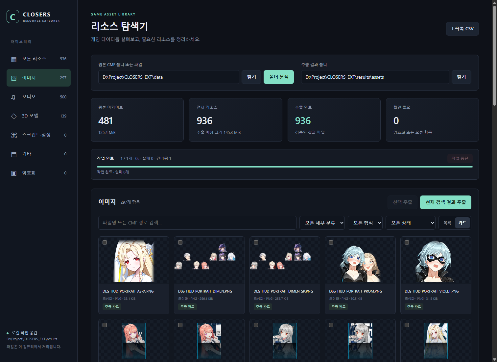

# CLOSERS Explorer

CLOSERS의 로컬 CMF 파일을 분석하고 리소스를 탐색·추출하는 Python 프로그램입니다. 한국어 웹 화면에서 이미지·오디오·스크립트를 확인하고, 이미지 조합과 3D 모델·XMD 동작 재생을 사용할 수 있습니다.



## 주요 기능

- CMF 폴더 분석, 파일명 검색과 분류·형식·상태 필터
- 원본 형식 추출, SHA-256 검증을 통한 재개, 원본 변경 비교와 저장 이력
- 이미지·오디오·텍스트 미리보기, 이미지 레이어 조합과 PNG 저장
- 캐릭터·의상·부위별 모델 검색, 아바타 묶음 구성, 3D 모델과 XMD 동작 보기
- 미지원 데이터의 저장 바이트 보존, HEADER 인덱스 및 CSV 내보내기

지원 형식과 제한, 상세 사용법은 [프로그램 설명서](CLOSERS_Explorer/README.md)를 참고하세요. 모든 CMF·모델 형식을 지원하지 않으며 별도 암호화 데이터의 복호화 기능은 없습니다.

## 실행 환경

- Python 3.10 이상. 개발·검증 환경은 Windows / Python 3.12입니다.
- 웹 브라우저. 3D 보기에는 WebGL2 지원이 필요합니다.
- DDS/TGA 미리보기·텍스처 변환 등에는 선택 패키지인 Pillow가 필요합니다.

```powershell
python -m pip install Pillow
```

기본 CMF 분석·추출에는 추가 Python 패키지가 필요하지 않습니다. Three.js는 저장소에 포함되어 있습니다.

## 처음 실행하기

1. 저장소를 내려받고 Python을 설치합니다. 터미널에서 `python --version`으로 실행 여부를 확인하세요.
2. `CLOSERS_Explorer/Start.cmd`를 더블클릭합니다. 또는 저장소 루트에서 다음 명령을 실행합니다.

   ```powershell
   python CLOSERS_Explorer/explorer.py
   ```

3. 브라우저의 `http://127.0.0.1:8765`에서 원본 CMF 폴더를 직접 지정합니다.
4. **폴더 분석**으로 목록을 만든 뒤 필요한 항목을 선택해 추출하거나 **분석하고 바로 추출**을 사용합니다.

게임 원본·샘플 CMF와 기존 분석 DB·추출 결과는 저장소에 포함하지 않습니다. 사용할 CMF 파일은 직접 준비해야 하며, 처음 실행하면 목록은 비어 있습니다. 원본은 저장소 밖의 폴더를 지정해도 됩니다.

기본 작업 폴더는 저장소 루트의 `results/`, 기본 추출 위치는 `results/assets/`입니다. 작업 폴더를 바꾸려면 다음처럼 실행하세요.

```powershell
python CLOSERS_Explorer/explorer.py --workspace "D:\CLOSERS-work" serve
```

서버를 종료하려면 실행한 콘솔 창에서 `Ctrl+C`를 누릅니다. 브라우저 탭만 닫으면 서버는 계속 실행됩니다. 포트가 사용 중이면 `serve --port 8766`으로 변경할 수 있습니다.

## 저장소 구성

| 경로 | 내용 |
|---|---|
| `CLOSERS_Explorer/explorer.py`, `Start.cmd` | 실행 진입점 |
| `CLOSERS_Explorer/closers/` | CMF 분석·추출, 목록 관리, 로컬 서버 |
| `CLOSERS_Explorer/web/` | 탐색·이미지 조합·3D 화면과 Three.js |
| `CLOSERS_Explorer/tests/` | 자동 테스트와 별도 검증 도구 |
| `CLOSERS_Explorer/docs/` | README용 사용 화면 이미지 |

`data/`, `results/`, `diagnostics/`, 기존 C# 참고 프로젝트인 `CLOSERS_CMFReader/`와 `docs/`의 개발 보고서·계획·진행 기록·인계 문서·벤치마크 결과는 Git 추적 대상에서 제외합니다. Explorer 실행에는 C# 프로젝트나 기존 진단 결과가 필요하지 않습니다.

## 테스트

```powershell
cd CLOSERS_Explorer
python -m unittest discover -s tests -v
```

브라우저 검증과 실제 게임 표본을 사용하는 검증은 별도 환경이 필요합니다. 조건과 실행 방법은 [검증 안내](CLOSERS_Explorer/README.md#검증-및-코드-구조)를 참고하세요.

## 출처

CMF 헤더 구조와 구형 디코딩 알고리즘은 기존 CMF-Sharp 구현을 참고했습니다. 해당 MIT 고지는 [THIRD_PARTY_NOTICES.md](CLOSERS_Explorer/THIRD_PARTY_NOTICES.md)에 보존되어 있습니다. 포함된 Three.js의 라이선스는 [Three.js LICENSE](CLOSERS_Explorer/web/vendor/three/LICENSE)를 참고하세요.
